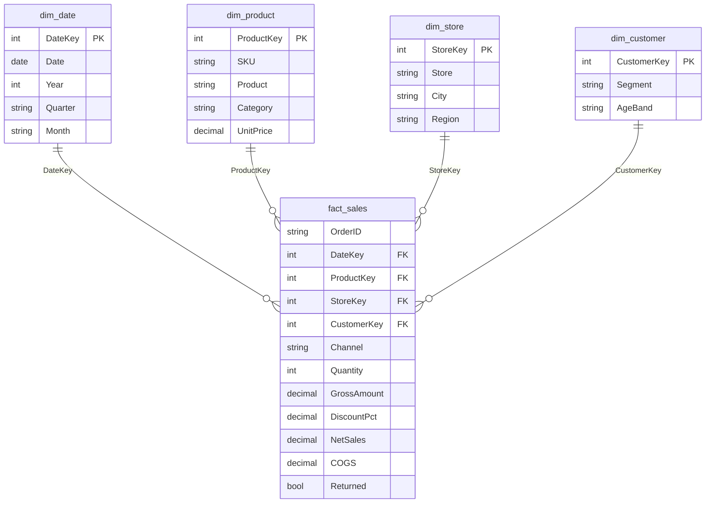

# Data model

Classic **star schema**: one fact table surrounded by conformed dimensions. All relationships are
**one-to-many, single direction** (dimension → fact), which keeps DAX predictable and fast.

## Modeling decisions

| Decision | Why |
|---|---|
| Integer surrogate keys (`DateKey` = `yyyymmdd`) | Smaller columns, faster relationships, VertiPaq-friendly |
| `dim_date` marked as date table | Required for time intelligence (`SAMEPERIODLASTYEAR`, `TOTALYTD`) |
| `Month` sorted by `MonthNo`, `Weekday` sorted by `WeekdayNo` | Correct axis order in visuals |
| Measures in a dedicated `_Measures` table | Clean field list, easy discovery |
| Hide foreign keys in `fact_sales` | Forces report authors to slice by dimension attributes |
| Hierarchies: Date (Year → Quarter → Month → Date), Geography (Region → City → Store), Product (Category → Product) | Drill-down without extra measures |
